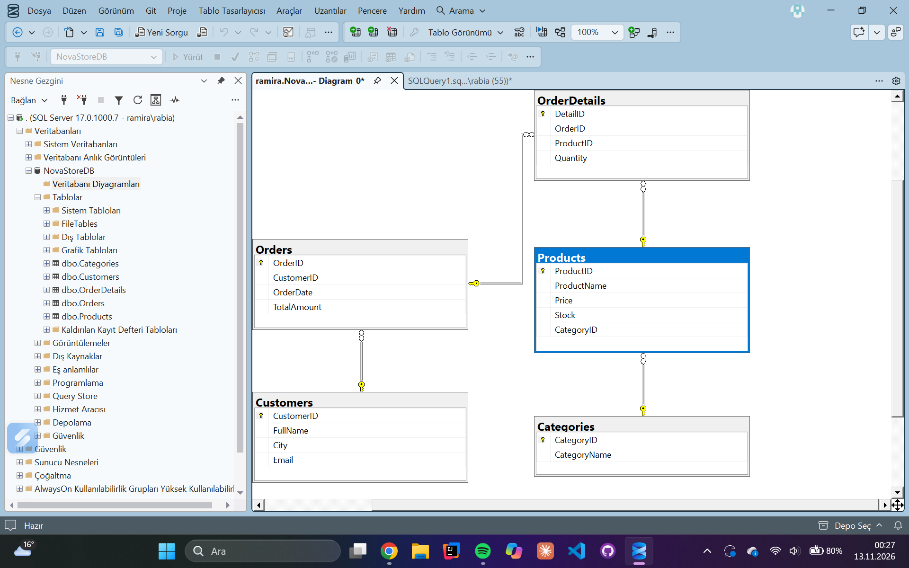

# 🛒 NovaStore E-Commerce Database Management System

Bu proje, **NovaStore** adlı bir e-ticaret platformunun ürün, kategori, müşteri ve sipariş süreçlerini yönetmek amacıyla **Microsoft SQL Server (T-SQL)** kullanılarak geliştirilmiş ilişkisel veri tabanı (RDBMS) tasarımı ve veri analizi çalışmasıdır.

---

## 📐 Veri Tabanı Mimarisi (ER Diagram)

Sistem, veri bütünlüğünü (Data Integrity) korumak amacıyla 3NF (Üçüncü Normal Form) kurallarına uygun olarak **5 ilişkisel tablo** üzerine inşa edilmiştir:

### Tablo Yapıları ve İlişkiler (DDL)
* **`Categories`**: Ürün kategorilerini tutan ana tablo (`CategoryID` PK, `IDENTITY(1,1)`).
* **`Customers`**: Müşteri bilgilerini barındıran ana tablo (`CustomerID` PK, `Email` `UNIQUE` kısıtlamalı).
* **`Products`**: Ürün detaylarını, fiyat ve stok bilgilerini tutan tablo (`CategoryID` FK, `Stock` varsayılan `0`).
* **`Orders`**: Müşterilerin sipariş başlıklarını, tarih ve toplam tutarlarını tutan tablo (`CustomerID` FK, `OrderDate` varsayılan `GETDATE()`).
* **`OrderDetails`**: Siparişler ile ürünler arasındaki çoktan-çoğa (M:N) ilişkiyi çözen ara tablo (`OrderID` FK, `ProductID` FK).

---

## 📊 İçerdiği SQL Çalışmaları ve Yetkinlikler

Depo içerisindeki [`NovaStoreDB_Script.sql`](./NovaStoreDB_Script.sql) dosyası aşağıdaki tüm aşamaları uçtan uca çalıştırılabilir şekilde içermektedir:

1. **DDL (Data Definition Language):** Veri tabanının (`NovaStoreDB`) ve tabloların Primary Key, Foreign Key, Identity, Unique ve Default kısıtlamalarıyla oluşturulması.
2. **DML (Data Manipulation Language):** Kategoriler, ürünler, müşteriler ve sipariş detayları için tutarlı test verilerinin (`INSERT INTO`) eklenmesi.
3. **DQL & İleri Analiz Sorguları:**
   * **Kritik Stok Analizi:** Stok miktarı belirli bir eşiğin (20 adet) altında kalan ürünlerin tespiti (`WHERE`, `ORDER BY DESC`).
   * **Müşteri-Sipariş Eşleştirmesi:** `INNER JOIN` ile müşteri bazlı sipariş geçmişi raporlaması.
   * **Çoklu Tablo Birleştirme (5-Table Join):** Müşteri, sipariş, sipariş detayı, ürün ve kategori tablolarının zincirleme birleştirilmesiyle detaylı ürün kırılımı.
   * **Kategori Dağılım Analizi:** `LEFT JOIN`, `GROUP BY` ve `COUNT()` kullanılarak kategorilere göre ürün sayılarının çıkarılması.
   * **Müşteri Ciro (LTV) Analizi:** `SUM()`, `GROUP BY` ve `ORDER BY` ile şirkete en fazla ciro kazandıran müşterilerin sıralanması.
   * **Zaman Analizi:** `DATEDIFF()` ve `GETDATE()` fonksiyonları ile siparişlerin üzerinden geçen gün sayısının dinamik hesaplanması.
4. **Veri Tabanı Nesneleri & Yedekleme:**
   * **`vw_SiparisOzet` (View):** Sık kullanılan 4 tablolu birleştirme sorgularını basitleştiren sanal tablo (View) yapısı.
   * **Full Backup:** `BACKUP DATABASE` komutu ile veri tabanının `.bak` formatında tam yedeğinin alınması.

---

## 🚀 Kurulum ve Çalıştırma

1. **SQL Server Management Studio (SSMS)** uygulamasını açın ve yerel sunucunuza bağlanın.
2. [`NovaStoreDB_Script.sql`](./NovaStoreDB_Script.sql) dosyasını açın.
3. *(İsteğe Bağlı)* Dosyanın en sonundaki `BACKUP DATABASE` komutunun hatasız çalışması için bilgisayarınızda `C:\Yedek` klasörünün bulunduğundan emin olun.
4. **`F5` (Execute)** tuşuna basarak veri tabanını, tabloları, örnek verileri ve analiz raporlarını tek seferde oluşturun.

---

## 🛠️ Kullanılan Teknolojiler
* **Veri Tabanı Motoru:** Microsoft SQL Server (T-SQL)
* **Yönetim Aracı:** SQL Server Management Studio (SSMS)
